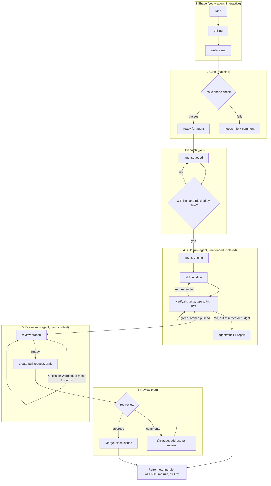
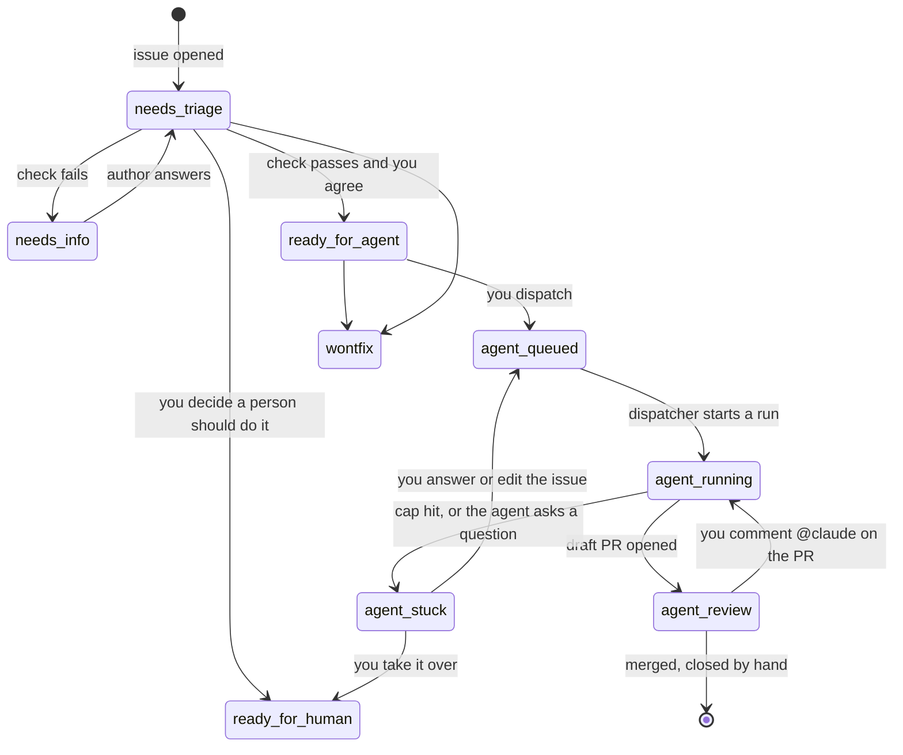

# Agent loop: from a labelled issue to a reviewed PR

- **Status:** Proposed (2026-10-14). Nothing here runs yet.
- **Tracking issue:** #620.
- **Read next:** [research.md](./research.md) (what others do, with sources), [slices.md](./slices.md) (two proposed epics, ready for `write-issue`), [sketches/](./sketches/) (an inactive workflow, [agent-run.yml](./sketches/agent-run.yml), and the agent's [run prompt](./sketches/run-prompt.md)).

## Why this exists

Today every agent run starts with you in a chat window. You pick an issue, open a worktree, steer the agent through `tdd`, `review-branch` and `create-pull-request`, and watch it the whole time. The skills already make each step reliable. What is missing is the part that lets the work happen **while you are away**: something that notices a ready issue, starts an agent in a safe place, keeps it honest, stops it when it runs too long or costs too much, and hands you a PR to review.

This document names those moving parts, says which ones the repo already has, and proposes the order to add the rest. It is a design to argue with, not a decision. The decisions it needs from you are collected in [section 10](#10-decisions-for-you).

The closest public example is OpenAI's **Symphony** (April 2026): the issue tracker is the control panel, every eligible ticket gets an agent in its own workspace, a cap limits how many run at once, each run keeps one "workpad" comment, and work stops in a Human Review state. This design borrows that shape and sizes it for one maintainer on GitHub. [research.md](./research.md) has the other sources.

## 1. Words used here

Each term is defined by what it is *for*, then named.

| Term | What it is for |
| --- | --- |
| **Agent loop** | Repeating "pick work → do it → check it → report" without a person driving each step. Here: issue in, PR out. |
| **AFK agent** | An agent that runs while you are away from the keyboard. `docs/agents/triage-labels.md` already uses the idea: `ready-for-agent` means "fully specified for an AFK agent". |
| **Harness** | Everything around the model that makes its output trustworthy: instructions (`AGENTS.md`, skills), tools, the sandbox, and the checks it must pass. The model is the engine; the harness is the rest of the car. |
| **Backpressure** | Checks that push back on the agent automatically: a failing test, a type error, a lint error, a stale `api.json`. The agent sees the failure and fixes it before you do. The more of it there is, the less you review by hand. |
| **Dispatch** | The moment a piece of work is handed to an agent. Separate from "ready": an issue can be ready for months before you choose to spend an agent run on it. |
| **WIP limit** | The most agent runs allowed in flight at once. It exists because your review time, not the agent, is the bottleneck. |
| **Human gate** | A step only you can pass: dispatching, approving, merging. The loop may wait at a gate; it may never skip one. |
| **Kill switch** | One setting that stops every agent run and every trigger at once. |

## 2. Where the repo is today

Evidence is from `origin/develop` at 262c2a3b and the GitHub settings of `av3000/japanese-vma`, checked on 2026-10-14.

| Moving part | Today | Gap |
| --- | --- | --- |
| **Spec format** | Issue shape with numbered acceptance criteria, Scope Out, Risk (`docs/agents/issue-tracker.md`, `.github/ISSUE_TEMPLATE/slice.yml`). | None. This is the strongest part, and the reason a loop is realistic here at all. |
| **Readiness check** | `write-issue` check mode scores Clarity, Completeness and Testability and gives Ready / Borderline / Blocked. | Only runs when you ask. Nothing stops a malformed issue from getting `ready-for-agent`. |
| **States (labels)** | `needs-triage`, `needs-info`, `ready-for-agent`, `ready-for-human`, `wontfix`. | About 80 open issues carry `ready-for-agent`, so the label means "well specified", not "start now". There is no label for "an agent is on it", "agent stuck", or "PR waiting for you". |
| **Dispatch** | You, in a chat. | No trigger, no queue, no WIP limit. |
| **Runtime** | Your Windows machine, a worktree per task, Docker test lanes (`docs/agents/local-environment.md`, PR #594). | No isolated place for an unattended run. Skills hard-code the Windows `gh` path, so they assume this machine. |
| **Agent context** | `AGENTS.md` files, repo skills in `.claude/skills/`, plugin skills (`tdd`, `grilling`, `diagnosing-bugs`) installed on your machine. | There is no `CLAUDE.md`. Claude Code reads `AGENTS.md` on its own only in recent versions and only when no `CLAUDE.md` exists, so a runner with another version could start with no rules at all. The plugin skills the main flow names are not in the repo. |
| **Environment bootstrap** | Backend CI already builds the whole test environment on a clean Linux runner: PHP 8.3, Composer, Postgres 17 and Redis services, Passport keys (`.github/workflows/backend-ci.yml`). Frontend CI does `npm ci`, Orval, typecheck, unit tests, style audit. | The steps live in two workflow files and two `AGENTS.md` files. There is no single "verify this change" command an agent can call. |
| **Backpressure** | Tests, `tsc`, Pint on changed files, the `api.json` drift check, the style audit, the skill drift check, the PR issue-link check. | No Claude Code hooks (issue #380 part B). Checks run in CI only after a push, so the agent learns about failures late. |
| **Self-review** | `review-branch` (Spec / Standards / Judgement × Critical / Warning / Suggestion). | Only runs when asked. |
| **PR evidence** | `create-pull-request` maps every AC to proof. | `scripts/check-pr-issue-link.mjs` **skips any author ending in `[bot]`**. A PR opened by an agent app would skip the acceptance-criteria check. |
| **Review gate** | You review every PR. | `develop` has no branch protection or ruleset. Actions workflows get **write** tokens by default, and **"Allow GitHub Actions to create and approve pull requests" is on**: a workflow could approve its own PR. |
| **Feedback loop** | `address-pr-review` answers every thread. | Only runs when asked. CI failures on a PR are fixed by hand. |
| **Learning loop** | Workflow step 4.5: mistakes become lint rules, judgement calls become written rules. | Manual, and there is no record of what agent runs got wrong. |
| **Budget** | Your weekly Claude quota, watched by you. | No per-run cap, no kill switch. |
| **Security boundary** | The repo is **public**: anyone can open an issue or comment. Actions allow every third-party action and do not require SHA pinning (#484 is open). `RENDER_DEPLOY_HOOK_URL` is a repository secret, not an environment secret. | Nothing yet separates text you wrote from text a stranger wrote before an agent reads it, and any workflow on any branch can name the deploy secret. |

The short version: the **spec side is already strong** (it is what Symphony and Anthropic's harness posts ask for), and the **runtime side does not exist yet**. The work is mostly plumbing and guardrails, not new skills.

## 3. The loop in one picture

Each box is one of the moving parts in [section 5](#5-the-moving-parts). Four things in it are deliberate:

- **Two labels, not one.** `ready-for-agent` stays a statement about the issue ("this is specified well enough"). `agent:queued` is a statement about your time ("spend a run on this now"). With one label, marking an issue as well specified would also spend a run on it, whether or not you have time to review the result, and the 80 issues already labelled would be one bulk edit away from 80 runs.
- **The builder does not review itself.** A second run, with none of the first run's conversation, does `review-branch` and opens the PR (section 5.6).
- **Every arrow back has a limit.** Retries, turns and minutes are capped. When the cap is hit, the run stops and reports instead of looping until it accidentally passes.
- **Every exit ends at you.** The loop opens a draft PR or reports that it is stuck. It never merges and never closes issues.

## 4. Label state machine

GitHub labels are the cheapest shared state there is: you see them in the issue list, workflows can read and set them, and agents can query them with `gh`. One state label at a time.

| Label | Set by | Meaning |
| --- | --- | --- |
| `needs-triage`, `needs-info`, `ready-for-human`, `wontfix` | unchanged | As in `docs/agents/triage-labels.md`. |
| `ready-for-agent` | you, after the shape check passes | Specified well enough for an AFK agent. Not a trigger. |
| `agent:queued` | **you only** | Spend a run on this. The trigger. |
| `agent:running` | dispatcher | A run is in progress. Its log link is in the issue's progress comment. |
| `agent:stuck` | the run | It stopped without a PR. The progress comment says why and what it needs. |
| `agent:review` | the run | A draft PR is open and waiting for you. |

Why the names use a prefix: GitHub sorts and filters labels as text, so `agent:` keeps them together, and none of the existing labels already uses that prefix.

## 5. The moving parts

Each part gets: what it is for, what to build here, and the cheapest version that works.

### 5.1 Intake and the issue shape check

**For:** an agent cannot ask you a question halfway through a run. Everything it needs has to be in the issue before dispatch. `write-issue` check mode already judges this; the missing piece is a **mechanical** check that cannot be skipped.

**Build:** `scripts/check-issue-ready.mjs`, the sibling of `check-pr-issue-link.mjs`. It runs on `issues: labeled` when the label is `ready-for-agent`. It checks what a script can check: an `## Acceptance criteria` heading with 3 to 7 `- [ ] AC-n` lines, at least one `Out:` line, and a `Risk` line. If anything fails, it removes the label, adds `needs-info`, and comments with the list. Judgement (is the AC actually testable?) stays with `write-issue`. Blockers are not part of readiness: a blocked issue can be ready, and the dispatcher waits for its blockers (5.2).

### 5.2 Dispatch, queue and WIP limit

**For:** your review time is the scarce resource. Many recent PRs into `develop` touch 50 to 170 files; an agent that opens three of those a night would bury you. The dispatcher's job is to say "not yet" more often than "go".

**Build:** a workflow on `issues: labeled` (`agent:queued`) plus a `workflow_dispatch` button. It:

1. checks that the person who added the label, and the issue's author, are the repo owner (see 5.9);
2. counts open `agent:running` and `agent:review` issues, and leaves the new one queued if the count is at the limit (start with **1**);
3. checks every `Blocked by` issue is closed;
4. checks the kill switch (5.10);
5. swaps `agent:queued` for `agent:running` and starts the run.

When a run ends, the same workflow picks the oldest queued issue, so the queue drains one at a time without you.

**Epics:** this repo delivers an epic as one branch with one commit per sub-issue (`docs/agents/workflow.md`). The loop keeps that. Queuing an **epic** runs its sub-issues in `Blocked by` order on one branch, one commit each, and opens one PR at the end. The epic's sub-issue checklist is the progress file: the agent ticks a sub-issue off after its commit, so a stopped run can resume from the next unticked one.

### 5.3 Runtime: where the agent runs

**For:** an unattended agent needs a place where a mistake costs nothing: no access to your other worktrees, your `.env` files, production secrets, or your Docker lanes.

**Recommendation:** a fresh **GitHub Actions runner** per run, using `anthropics/claude-code-action`. The runner is thrown away afterwards, backend CI already proves the test environment builds there, and every run leaves a log. The options and their trade-offs are in [section 6](#6-runtime-options); the "argue the other side" case for running locally is there too.

### 5.4 Environment bootstrap

**For:** half of the traps in `docs/agents/local-environment.md` are "the environment was not ready, and it looked like a bug". On an unattended run nobody is there to recognise that.

**Build:** one setup that both CI and the agent use, so they can never disagree.

- A composite action, `.github/actions/setup-workspace`, with the PHP, Composer, test env, Passport keys, Node, `npm ci` and Orval steps that `backend-ci.yml` and `frontend-ci.yml` repeat today. CI switches to it first, so the agent inherits a setup that is already proven green. The one thing it cannot hold is the Postgres and Redis `services:` block: GitHub only allows that at job level, so it stays copied in each job, with a comment pointing at the other copies.
- Make the agent's context portable:
  - Skills use `gh` from `PATH` and fall back to the Windows path only when it is missing. Today `address-pr-review`, `create-pull-request` and `review-branch` name `/c/Program Files/GitHub CLI/gh.exe`.
  - Add a one-line `CLAUDE.md` that imports `@AGENTS.md`, so every Claude Code version loads the same rules.
  - The plugin skills the flow names (`tdd` at least) are installed in the job through the action's `plugins` input, pinned to a version.

### 5.5 One verify command (backpressure)

**For:** an agent fixes what it can see. If the only signal is "CI went red ten minutes after the push", it learns late and guesses. One command it can run after every change turns CI's checks into the agent's inner loop.

**Build:** `scripts/verify.sh [--changed | --all]`. With `--changed` it looks at the diff against `origin/develop` and runs only what applies:

| Changed | Runs |
| --- | --- |
| `processor-api/**/*.php` | Pint `--test` on changed files, the affected test folders, `composer openapi` + `git diff --exit-code api.json` |
| `processor-api/api.json` | `npm run orval:file`, then `npm run typecheck` |
| `client/**` | typecheck, unit Vitest, style audit, ESLint on changed files |
| `.claude/skills/**` | `node scripts/lint-agent-skills.mjs`, the Codex mirror check |

It prints one line per check and exits non-zero on the first failure, with a hint for the fix (the way `backend-ci.yml` already explains a stale `api.json`). Locally the backend part runs inside the Docker lane; on the runner it runs directly.

Then add the Claude Code hooks from #380 part B, so the same checks run as the agent works, not only when it remembers to call them: a `PostToolUse` hook that formats the edited file, and a `Stop` hook that runs `verify.sh --changed` and blocks the stop while it is red.

### 5.6 The run itself

**For:** the agent follows the same path you do, so its PR looks like yours and the same review works on it.

**Build:** a run prompt (see [sketches/run-prompt.md](./sketches/run-prompt.md)) that is mostly pointers to things that already exist:

1. Read the issue with `gh issue view <n> --comments`. For an epic, every sub-issue.
2. Post a progress comment and keep editing it: current step, checks run, open questions.
3. Per slice: `tdd`, `verify.sh --changed`, one commit `<Stable ID>: <outcome>` with `Refs #N`.
4. Push the branch and stop. A **second run with a fresh context** does `review-branch` (see below), fixes Critical and Warning findings, and repeats at most twice.
5. `create-pull-request` as a **draft**, with the `review-branch` verdict in the body.
6. Anything out of scope: a `needs-triage` issue, never a change on this branch.
7. Stop and set `agent:stuck` instead of guessing when an AC is ambiguous, a check fails after three attempts, or the change needs a migration, auth or contract change the issue did not mention.

**Why the review is a separate run.** Anthropic's harness research found that agents grade their own work too generously: the session that wrote the code also wrote the story of why it is right, and reads its own diff through that story. A reviewer that starts cold, with only the issue, the diff and the rules, catches more. This is the maker/checker split. It costs one more run per issue, which is cheap next to a review round with you. Locally `review-branch` stays inline, as `docs/agents/workflow.md` says; the split applies to unattended runs, where you are not there to be the fresh eyes.

### 5.7 Review gate

**For:** the agent's PR has to reach you, and only you can let it into `develop`.

**Build:**

- A **ruleset on `develop`**: changes only by PR, the backend, frontend and issue-link checks must pass, and no force pushes. Owner bypass stays on so your own merges are not slowed down.
- Turn **off** "Allow GitHub Actions to create and approve pull requests" and set default workflow permissions to **read**. Each workflow then asks for exactly what it needs. Agent PRs are opened by the agent's own GitHub App (5.9), so nothing needs this setting.
- Fix the `[bot]` exemption in `check-pr-issue-link.mjs`: keep it for Dependabot, require issue links from the agent's App.
- Agent PRs open as **drafts**. "Ready for review" is a click you make after reading the evidence table.

### 5.8 Feedback: CI failures and review comments

**For:** most of the value of an agent is in the second and third attempt, when the PR already exists.

**Build:**

- `@claude` (the action's default trigger phrase) in a PR comment from you runs `address-pr-review` on that PR. The action already refuses comments from users without write access; the workflow also checks the commenter is you.
- A **CI auto-fix** job: when a check fails on an `agent:review` PR, start one run that reads the failing log and pushes a fix. At most **two** per PR, then `agent:stuck`. Without the cap, a flaky test becomes an endless loop.

### 5.9 Security boundary

**For:** the repo is public, so anyone can write text an agent might read. This is not hypothetical: in 2025 and 2026 every major CI agent integration (Claude Code's action, Gemini CLI's, Codex's, Copilot's) had a published case where text in an issue, PR title or comment made the agent leak its own secrets. The incidents and sources are in [research.md](./research.md#3-security).

The useful way to think about it is Simon Willison's **lethal trifecta**. An agent is dangerous when it has all three of:

1. **Something worth stealing:** here, the model API key, the GitHub token, and any deploy secret the job can see.
2. **Text from strangers:** issue bodies, comments, PR titles, hidden HTML comments, edits made after you labelled the issue.
3. **A way to send data out:** and here GitHub itself is one. A comment, a pushed branch or a PR body is public, so an outbound network filter can never fully close this leg.

Since leg 3 cannot be closed, the design removes as much of legs 1 and 2 as it can:

1. **Only you can start a run, and only on your text.** The dispatcher checks that the person who added `agent:queued` (`github.event.sender`) is the owner **and** that the issue was written by the owner. An external issue you want worked gets rewritten by you, in your own issue. Reason: a published claude-code-action report shows that checking only who added the label still let another user's comment into the run.
2. **The prompt carries the issue number, never its text.** The workflow never pastes `github.event.issue.body` or a title into the prompt or into a `run:` line; the agent fetches the issue itself and treats anything not written by the owner as data (see [sketches/run-prompt.md](./sketches/run-prompt.md)).
3. **No deploy secrets anywhere an agent job can reach.** Move `RENDER_DEPLOY_HOOK_URL` into a protected **GitHub Environment** (`production`, you as required reviewer, deployable only from `master`). Environment secrets are only released to jobs that name that environment, and the agent job never does.
4. **A minimal GitHub App as the agent's identity.** Neither of the obvious tokens fits:
   - The workflow's own `GITHUB_TOKEN`: a PR it opens **does not trigger other workflows**, so backend and frontend CI would never run on agent PRs.
   - The official Claude GitHub App: Anthropic's docs list it with write access to workflows, actions and repository hooks, which is far more than a coding run needs.
   - So: a small private GitHub App you create, with only Contents, Issues and Pull requests read/write. Its token triggers CI, cannot change workflow files, and is minted per run.
5. **Least privilege inside the job.** Explicit `permissions:` with no `id-token`, `actions` or admin scopes; the repository default token set to read-only. Later (phase 3), split the run in two: the agent job has read-only access and produces a patch; a second, non-agent job pushes it and opens the PR.
6. **Protect the files that steer agents and CI.** A `CODEOWNERS` entry for `.github/**`, `AGENTS.md` files, `.claude/**`, `.codex/**`, Dockerfiles and Compose files, and a CI check that fails an agent PR touching any of them. (GitHub's file-path push rule is not available for public repos, so the check does the job.)
7. **Restrict tools and network.** An explicit `--allowedTools` list (named commands such as `scripts/verify.sh`, `git`, `gh issue`, `gh pr`; no unrestricted Bash; no web fetch or search), plus `step-security/harden-runner` in audit mode first, then blocking everything except GitHub, npm, Packagist and the model API.
8. **Pinned and current.** `anthropics/claude-code-action` pinned to a commit SHA (#484) at a release that includes the 2026 security fixes listed in research.md, and the "Require actions to be pinned to a full-length commit SHA" setting turned on.
9. **Never widen the trigger.** Do not set `allowed_non_write_users` or `allowed_bots`. Two of the published incidents (Clinejection, and the chain fixed in v1.0.94) started exactly there: a trigger opened to any user, and a trigger that trusted any bot.
10. **Assume the model key can leak.** Use a dedicated API key with a monthly spending limit, never your personal subscription token (decision D2), and rotate it if a run ever prints something odd.

### 5.10 Budget and kill switch

**For:** a loop that runs while you sleep can also spend while you sleep. Your weekly quota already runs out.

**Build:**

- A repository variable `AGENT_LOOP_ENABLED`. Every agent workflow checks it first. Setting it to `false` stops all triggers; cancelling the `agent-run` concurrency group stops anything in flight.
- Per run: `timeout-minutes` on the job, `--max-turns` for the agent, and one concurrency group so two runs never overlap. The Claude Code CLI also documents `--max-budget-usd` for headless runs; use it if the action passes it through.
- Per week: a cap on runs (start with 5), counted from the issues that reached `agent:running` in the last seven days.
- Choose the auth on purpose (decision D2): a subscription token draws from the same weekly quota as your interactive work, while an API key is billed separately per token and can have its own spending limit.

### 5.11 Observability

**For:** you will judge the loop by its results, so it has to leave a trail you can read in a minute.

**Build:**

- The **progress comment** on the issue: state, current step, link to the run, checks run, and the final outcome. The action posts a tracking comment on its own only in its interactive mode; with a `prompt` it does not, so the run prompt asks for one. Symphony calls the same thing a workpad.
- The **job summary**: turns, duration, retries, checks run, verdict.
- A weekly **scorecard** (section 9) built from labels and PRs with `gh`, no extra service.

### 5.12 Learning loop

**For:** without it the same mistake costs a run every week.

**Build:** keep the retro from `docs/agents/workflow.md` step 4.5, and give it data. Every `agent:stuck` report and every Critical or Warning finding on an agent PR is filed or tagged, and the weekly scorecard lists the repeats. A repeat becomes a lint rule, a hook, a `verify.sh` check, or an `AGENTS.md` line, in that order of preference: the machine-enforced versions cannot be talked past.

## 6. Runtime options

The full comparison, with sources, is in [research.md](./research.md#2-where-the-agent-runs). The summary for this repo, as of October 2026:

| Option | How it starts | Where it runs | Strengths | Weaknesses here |
| --- | --- | --- | --- | --- |
| **A. `claude-code-action`** (recommended) | Label, assignee, `@claude`, or any event with a `prompt` | A fresh GitHub Actions runner | Generally available (v1); runs the repo's own skills; your job definition, so Postgres and Redis work exactly as in backend CI; standard runners are free on public repos | Needs a model key and an App key as secrets; the plugin skills (`tdd`, `grilling`) must be installed in the job (`plugins` input) or copied into the repo; no network filter of its own |
| **B. Copilot cloud agent** (and Agent HQ) | Assign the issue to Copilot (no label trigger); Agent HQ also lets you assign Claude or Codex | GitHub's own environment | Mature draft-PR flow: `copilot/` branches only, cannot approve or merge, workflows wait for your click; reads `AGENTS.md`; firewall on by default | Paid through Copilot credits, not your Claude subscription; another setup file (`copilot-setup-steps.yml`) to keep equal to CI; 59-minute cap; Agent HQ is in preview |
| **C. GitHub Agentic Workflows (`gh-aw`)** | `label_command`, slash commands, schedules | Your runner, sandboxed | The safest shape on paper: the agent job holds no write token, its writes are checked afterwards ("safe outputs"), draft PRs and protected files by default | Technical preview (0.x); the Claude engine needs an API key; no published example of a build-and-test PR with a database |
| **D. A local dispatcher** | A script on your machine polls for `agent:queued` | Your Windows machine, a worktree per run, `claude -p` | No AI secret in GitHub; uses your Docker lanes; your subscription | Only runs while the machine is on; unattended code shares your disk, Docker and `.env` files; every trap in `local-environment.md` applies |
| **E. Claude Code cloud session or routine** | Schedule, an API call, or PR events (not issue events) | Anthropic's VM: PHP 8.3, Composer, Node, Docker, Postgres and Redis preinstalled | No runner to maintain; your subscription | Routines are a research preview; an issue label needs a small workflow that calls the routine's API; the environment is not CI's |
| **F. Codex** (`@codex`, `codex-action`) | `@codex` on PRs; any event via the action | OpenAI's cloud, or your runner | `.codex/skills` mirror exists; good PR review | No documented issue trigger; the cloud integration is mid-migration; `codex-action` needs an API key, and OpenAI advises against ChatGPT sign-in on public repos |

**Why A:** it is the only mature option where the agent's environment and CI's can be literally the same setup action (5.4), which removes the biggest source of false failures. It runs the skills the whole workflow is built on, and it keeps every run's log next to the PR.

**Watch C.** `gh-aw` is built around the security model of 5.9 (no secrets in the agent job, writes checked after it exits), which A only reaches by splitting the job by hand. When it leaves preview, re-evaluate; the issue shape, labels, `verify.sh` and setup action carry over unchanged.

**Arguing for D instead:** if keeping any AI token out of a public repo's secrets matters more to you than isolation, the local dispatcher is honest about its trade: you get no secret in GitHub and lose the clean sandbox. A middle path is to start with D for read-only jobs (nightly triage) and use A for anything that writes code.

**Not recommended:** a self-hosted GitHub runner on your machine. On a public repository, a workflow triggered by someone else's PR could run on it.

**Settings that matter for A,** from its `action.yml`:

- `base_branch: develop`. It defaults to the repository's default branch, which here is `master`.
- `github_token`: the agent App's token. Leaving it out authenticates as the official Claude App (5.9); passing the workflow's `GITHUB_TOKEN` means CI never runs on the agent's commits.
- `prompt`: the run prompt. With a `prompt`, the action runs on any event and skips its own trigger matching, so the dispatcher's checks (5.2) are the only gate. That is intended: one gate, in code you own.
- `include_comments_by_actor: av3000`, so other people's comments never reach the prompt.
- `claude_args`: `--max-turns`, `--model` and `--allowedTools`. Bash is off unless allowed, so the allow-list is also what lets it run `scripts/verify.sh`.
- `plugins` and `plugin_marketplaces` for the plugin skills.
- Leave `allowed_bots`, `allowed_non_write_users`, `show_full_output` and `display_report` at their defaults; each one either widens who can trigger a run or publishes the agent's output in a public log.
- The action does not open the PR itself; it pushes a branch. The run prompt asks for `gh pr create --draft`, and the allow-list permits exactly that.

## 7. Jobs other than "build this issue"

Once the run, verify and review parts exist, the same harness can take on smaller jobs. These are the ones with the best ratio of value to risk here, all producing a comment or a draft PR, never a merge:

| Job | Trigger | Output |
| --- | --- | --- |
| **Triage** | New issue, or nightly over `needs-triage` (92 open today) | `write-issue` check-mode scores and proposed edits as a comment. You apply the label. |
| **CI auto-fix** | A failed check on an `agent:review` PR | One fix commit, at most two per PR |
| **PR review comments** | `@claude` from you | `address-pr-review` replies and one fix commit |
| **Self-review record** | An agent PR is marked ready | `post-review-to-pr` |
| **Drift sweep** | Weekly | Draft PR or issue for stale docs, dead links in `AGENTS.md`, finished worktree branches, skill mirror drift |
| **Dependabot triage** | A Dependabot PR | A risk comment: what changed, which code uses it, whether tests cover it |

## 8. What could go wrong

| Risk | What it looks like | Guard |
| --- | --- | --- |
| **Review flood** | More PRs than you can read; you start skimming | WIP limit of 1; draft PRs; evidence table; a weekly run cap |
| **Gaming the checks** | Tests deleted or weakened to go green, `@ts-ignore`, `skip()` | `review-branch` Spec check against the AC; a `verify.sh` check that fails on new skips or ignores; read the test diff first |
| **Scope creep** | The agent "also fixes" nearby code | Scope Out lines; the out-of-scope → `needs-triage` rule; `review-branch` flags files the issue does not mention |
| **Environment false failures** | Red checks that are setup, not code | One shared setup action; `verify.sh` hints |
| **Endless loops** | Retry after retry on a flaky test | Caps on retries, turns, minutes; `agent:stuck` |
| **Prompt injection** | A stranger's text steers the agent | Owner-only dispatch; issue body only; no deploy secrets; egress allow-list |
| **Quota burn** | The week's quota gone by Tuesday | Weekly run cap; separate API key with a spending limit (D2) |
| **Context rot** | Long epics where the agent forgets early decisions | One sub-issue per commit; the issue checklist as the progress file; a fresh run per sub-issue when an epic is long |

## 9. Is it working?

A weekly scorecard, made with `gh` from labels and PRs, so it costs nothing to keep. The "healthy" values are starting guesses; adjust them after the first ten runs.

| Measure | Healthy | Says what |
| --- | --- | --- |
| Runs that reach `agent:review` | 70% or more | Issues are specified well enough |
| `agent:stuck` reasons | Each reason appears once | Recurring reasons are missing rules or checks |
| Agent PRs merged without a fix commit from you | Rising | The harness is catching what you used to |
| Review rounds per agent PR | 1 to 2 | Self-review is doing its job |
| Time from `agent:review` to merge | Shorter than for your own PRs | Evidence tables make review fast |
| Runs per week vs cap | Below the cap | Budget is under control |

If the first three issues through the loop do not reach at least two of these, stop and fix the harness before dispatching more. More runs on a weak harness only make more review work.

## 10. Decisions for you

| # | Question | Recommendation | The other side |
| --- | --- | --- | --- |
| D1 | Where do runs happen? | A: GitHub Actions with `claude-code-action` | D (local) keeps tokens out of GitHub, at the cost of isolation |
| D2 | Which auth for CI runs? | A dedicated API key with its own monthly spending limit. CI runs never eat the interactive quota, and if the key leaks the damage is capped | A subscription token is simpler and already paid for, but shares the weekly limit, and a leak exposes your personal account |
| D3 | Dispatch label | `agent:queued`, owner only | Assigning the issue to the bot user is also supported by the action and reads well in the UI, but is easier to do by accident |
| D4 | First WIP limit and weekly cap | 1 in flight, 5 a week | 2 in flight if the first ten runs need little rework |
| D5 | Epics or single slices first? | Single slices for the first three runs, then epics | Epics are the real unit here, so starting there tests the real flow sooner |
| D6 | Does `develop` get a ruleset? | Yes, with owner bypass | Without it, the only thing stopping an agent push to `develop` is the prompt |
| D7 | Codex as a second engine? | Not until the Claude loop has run ten times | The `.codex/skills` mirror already exists, so a second engine is cheap to try |

## 11. Rollout

Each phase ends with a check you can see. Do not start the next phase until it passes.

| Phase | Adds | Done when |
| --- | --- | --- |
| **0. Today** | Skills, issue shape, CI checks | (already true) |
| **1. Agent-ready repo** | Shared setup action, `verify.sh`, hooks (#380 B), portable skills and a `CLAUDE.md` import, `check-issue-ready.mjs`, new labels, the `[bot]` fix, the ruleset, read-only default token, deploy secret in a protected environment, `CODEOWNERS` and the path guard, SHA pinning (#484) | An interactive session in a fresh worktree reaches green with only `verify.sh` and no help from you |
| **2. Supervised runs** | The dispatcher (owner only, WIP 1, kill switch, weekly cap), the build run, the fresh-context review run, the progress comment, draft PRs, `agent:stuck` reports | Three single-slice issues reach `agent:review`, and you merge them with no more than one fix commit each |
| **3. Feedback loops** | `@claude` on agent PRs, CI auto-fix with a cap of two, the weekly scorecard | One review round handled end to end by the agent |
| **4. Epics** | Sub-issues in `Blocked by` order on one branch, the checklist as the progress file, a fresh run per sub-issue | One small epic (3 to 4 slices) delivered as one PR |
| **5. Side jobs** | Nightly triage, drift sweep, Dependabot triage (section 7) | A month of side jobs with no comment you had to delete |

The proposed issues for phases 1 to 3 are in [slices.md](./slices.md).

## 12. When this folder goes away

This is a proposal, so it is written as a document. Once you have made the decisions in section 10:

- the slices in `slices.md` become GitHub issues through `write-issue`, and `slices.md` is deleted;
- D1 and D2 become an ADR in `docs/adr/`, because they are the ones most likely to be argued about again;
- the rules an agent must follow move into `AGENTS.md` and `docs/agents/workflow.md`, where agents already look;
- this README and `research.md` are deleted when the last phase-3 issue closes. By then the code and the ADR say what this does.
